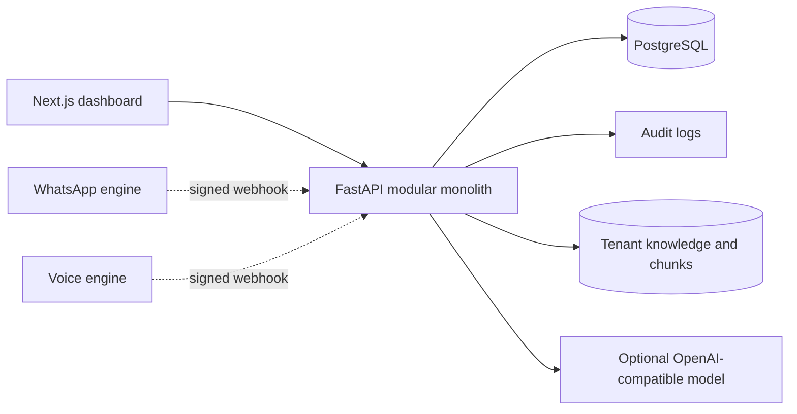
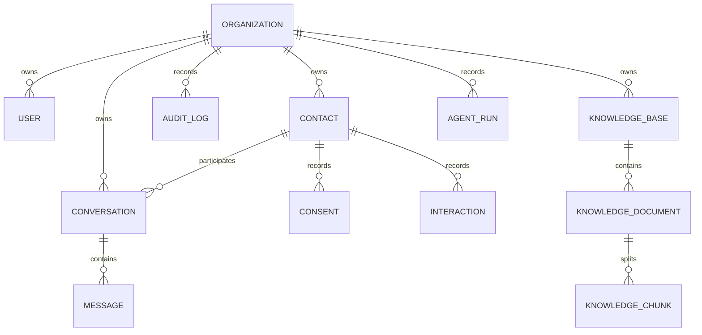
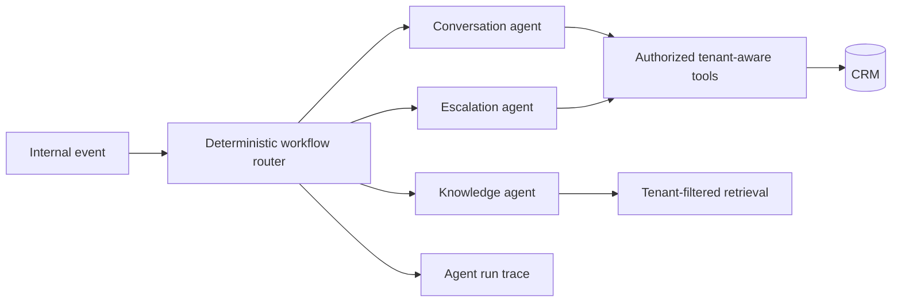

# Architecture assessment and implementation plan

## Repository assessment

The repository had no application files or prior commits. No WhatsApp engine, voice engine, model infrastructure, frontend, or backend was available to inspect or preserve. The supplied specification is therefore the product target; this repository starts with an independently runnable CRM foundation. An attempt to create `codex/engagement-crm-foundation` was blocked by read-only `.git` permissions, so these working tree changes remain on `main` and are uncommitted.

## Current architecture

The API owns tenant validation, authorization, consent, contacts, conversations, interactions, and audit records. External sends are recorded as durable outbound jobs. A worker retries them with a consent recheck; the two engines are external integration points behind `CommunicationGateway`. Redis is provisioned for future caching and rate limiting but is not yet consumed.

## Entity relationships

Each tenant-owned row stores `organization_id`. Queries constrain it using the authenticated user's tenant. The webhook payload carries an organization ID and is accepted only after an HMAC signature check. In a production integration, provision a distinct signing secret per engine/tenant, configure replay windows, and register engine credentials rather than sharing one secret.

The provisional outbound engine contract is `POST {ENGINE_URL}/messages` with a bearer token and JSON `{organization_id, contact_id, conversation_id, content, idempotency_key}`. Engines return `{status: "queued" | "sent" | "delivered", external_id?: string}`. Delivery callbacks use `POST /api/v1/webhooks/{channel}/delivery` with an HMAC signature and `{organization_id, external_event_id, message_id, status, external_id?}`. The real WhatsApp and voice contracts must be mapped once those engines are available. Voice call start/end remains to be implemented.

## Target agent architecture

The first knowledge-agent path is implemented: approved tenant documents are chunked, retrieved, optionally sent to a configured OpenAI-compatible model, validated for known citations and lexical grounding, and logged as agent runs. The full orchestrator and tool registry remain planned. Agents should never receive unrestricted database access.

## API contract implemented

OpenAPI is generated at `/docs`. Current routes: organization creation; login and current user; user creation; contact list/create/import/read/update; consent records; conversation list/create/read; scoped web chat; outbound messaging; signed inbound/delivery engine webhooks; knowledge bases/documents/approval/search/ask/runs; overview analytics. JSON errors use standard FastAPI HTTP status codes. Normal business routes require bearer authentication; web chat uses a scoped contact token.

## Gap analysis and PR-sized plan

| Phase | Outcome | State |
|---|---|
| 1 | Authentication, roles, tenant-safe contacts, imports, profiles, interactions, conversations, consent, audit | Implemented foundation; load and security review pending |
| 2 | Actual WhatsApp and voice outbound adapters, delivery callbacks, reliable queue, per-engine credentials | Durable queue, worker, provisional adapter, and signed callbacks implemented; engine contracts and per-engine credentials unavailable |
| 3 | Explicit agent tools, orchestrator, model router, tenant-filtered knowledge ingestion and retrieval | Tenant knowledge, cited answers, optional model adapter, and run tracing implemented; tools/orchestrator/vector index remain |
| 4 | Campaign approvals, survey and follow-up workflows, analytics dashboards | Reviewed campaign flow, consent-filtered web/WhatsApp dispatch, surveys and response reports, follow-up task scan, template content drafts, and controlled count analytics implemented; audience segments, scheduled campaigns, dynamic survey interviewing, model-based content and deeper trends remain |
| 5 | Data hygiene, escalation, advanced analytics, onboarding, usage billing | Reviewable hygiene findings, deterministic escalation queue, 14-day metrics, authenticated workspace discovery, and usage metering implemented; destructive merges, model-based classification, cross-workspace membership, payment integration, and production-scale analytics remain |

Migrate via Alembic before the API starts. Later migrations should add the remaining tables and indexes without dropping existing records. For large imports, replace request-bounded CSV processing with an object-store-backed queued import that supports checkpointing and row-level error reports. Benchmark with 100,000 contacts before claiming the stated capacity.

## Security and operations notes

The current JWT is sent as a bearer token and stored in browser local storage. For production, move to a secure HttpOnly session or equivalent, add MFA, strict token rotation and revocation, rate limiting, per-tenant webhook secrets, upload scanning, metrics, backups, and a tested restore procedure. Database-level row security is recommended as defense in depth. The current schema and UI form a working development foundation, not a production certification.

Knowledge retrieval is currently lexical and capped to 1,000 matching chunks per query; it is suitable for the local demonstration, not a validated large-scale index. Pasted text and bounded PDF/DOCX/TXT/Markdown/HTML uploads are extracted and stored in the CRM database. Upload scanning and OCR are not implemented. Model generation is disabled until an operator configures an endpoint. Retrieved text is treated as untrusted context, and source IDs are checked, but citations alone cannot prove semantic truth. A domain-specific answer evaluation set is required before automatic replies are enabled.
